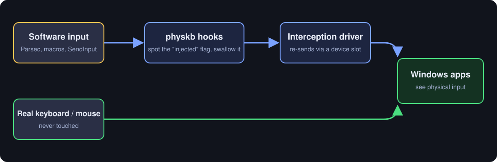

<p align="center"></p>

# physkb

Re-send injected keyboard and mouse input through the [Interception](https://github.com/oblitum/Interception) driver, so Windows apps see it as coming from a physical device instead of from software.

Typical use: remote-desktop / game-streaming hosts (Parsec, Moonlight, ...), macro and remapping tools, and accessibility setups, where some applications ignore or mishandle input that carries Windows' "injected" flag.

## How it works

Software input (`SendInput`, remote-desktop injection, most macro tools) is marked with an *injected* flag (`LLKHF_INJECTED` for keys, `LLMHF_INJECTED` for the mouse). physkb:

1. installs low-level keyboard / mouse hooks,
2. spots injected keys, clicks and wheel events,
3. swallows them, and
4. sends the same event through a real device slot of the Interception driver, which enters Windows below that flag.

Real hardware input is never touched.

<p align="center"></p>

> **Warning: read before installing the driver.** Interception is a kernel driver that sits in the path of *every* keyboard and mouse on the machine, even when physkb is not running. It is old and unsigned by modern standards, and on at least one setup (Windows 11, after the driver was installed and physkb was set up) the **physical keyboard stopped typing and the mouse started jumping**, while the on-screen keyboard still worked. Removing the driver is what fixes that, so know the way out **before** you install it: see [Recovery](#recovery-keyboard-or-mouse-stopped-working). Try it on a machine where you can still reach the on-screen keyboard (Win+Ctrl+O), not on your only computer.

## Requirements

- Windows 10 / 11, 64-bit PowerShell 5.1+
- The Interception driver installed (admin prompt, then **reboot**):
  1. Download from <https://github.com/oblitum/Interception/releases>
  2. Unzip, e.g. to `C:\Interception`
  3. `install-interception.exe /install`, reboot
- Memory Integrity (Core isolation) can block this older driver on some systems.

physkb auto-detects `interception.dll` in common places (`C:\Interception\library\x64`, next to the script, `%INTERCEPTION_DIR%`, `PATH`). Otherwise pass `-DllDir`. The DLL and driver are **not** bundled here; they have their own license.

## Quick start

```powershell
powershell -ExecutionPolicy Bypass -File .\physkb.ps1
```

On first run a short wizard lists your detected devices and asks which keyboard and mouse slot to send through. Your choice is saved to `%APPDATA%\physkb\config.json`. After that, just run the script again. It re-launches itself elevated if needed.

Verify it works with the included checker. Start it **first**, then physkb, then type and click from your remote session:

```powershell
.\Test-InjectedInput.ps1
```

Yellow lines are injected (software) input, green lines are physical. Input handled by physkb should show green.

## Options

| Option | What it does |
|---|---|
| `-Setup` | Run the device wizard again |
| `-List` | Show detected device slots and exit |
| `-Device N` | Keyboard slot (1-10); `0` leaves the keyboard alone |
| `-MouseDevice N` | Mouse slot (11-20); `0` leaves the mouse alone |
| `-MouseMoves` | Also re-send cursor movement (experimental, off by default) |
| `-MouseRelative` | With `-MouseMoves`: relative deltas instead of absolute positions |
| `-Trace` | Print each key / click seen and what happened to it |
| `-Observe` | Only report what is seen; swallow and re-send nothing (use with `-Trace`) |
| `-DllDir <folder>` | Folder containing the x64 `interception.dll` |
| `-ForgetConfig` | Delete saved settings |

## Safety

- **Ctrl+Shift+F12** switches physkb off/on at any time without closing it. While off, everything passes through unchanged.
- If re-sent mouse events never come back as physical events, physkb automatically tries your other mouse slots, then switches mouse handling off rather than leaving you without a working mouse.
- `-Observe` is always safe to try first.
- Stop with Ctrl+C or by closing the window; hooks are removed on exit.

## Limitations

- A hook-based program that is already running will still see the injected original before physkb swallows it, because Windows calls the most recently installed hook first. Start physkb **last**.
- Cursor movement is **not** re-sent by default, so mouse moves still carry the injected flag. `-MouseMoves` exists but is experimental: absolute moves through Interception are poorly behaved on some mice, and relative moves are subject to pointer acceleration.
- Unicode text packets (`VK_PACKET`) are passed through unchanged.
- Apps that read the sending *device* through Raw Input will see the slot you chose.

## Tested

Developed on one setup: Windows 11, Dell keyboard, Razer mouse, input arriving through Parsec. On that setup, keyboard re-send and mouse clicks/wheel were confirmed to arrive as physical input (using early versions of the code; the setup wizard was run on the current version). Not yet verified: `-MouseMoves`, mouse slot auto-failover and saved-config reuse across restarts on other hardware. Reports for other setups are welcome.

## Troubleshooting

- **"interception.dll not found" / driver errors:** install the Interception driver (`install-interception.exe /install` from an admin prompt) and **reboot**. Then point physkb at the x64 `interception.dll` with `-DllDir` if it isn't found automatically.
- **My keyboard or mouse isn't listed:** Interception only lists devices Windows currently sees. Reconnect the device and run `.\physkb.ps1 -List`. If the only keyboard shown is `Virtual device`, plug in a real USB keyboard and run `-Setup`. The slot is just the device your re-sent keys pass through, so it doesn't have to be the keyboard you type on.
- **Slot numbers changed:** slots can shift after plugging, unplugging or rebooting. If behaviour changes after a hardware change, run `.\physkb.ps1 -Setup` instead of trusting the saved settings (`-ForgetConfig` clears them).
- **Keys or clicks do nothing:** run with `-Observe -Trace` to see what is detected without changing anything. Then run with `-Trace` and look at the `result=` value: `1` means the driver accepted the event. For the mouse, a matching `injected=False` line should follow each re-sent click.
- **Mouse feels stuck:** press **Ctrl+Shift+F12** to switch physkb off, then run `-Observe -Trace`. Leave `-MouseMoves` off.
- **Characters appear twice:** another hook-based tool started after physkb. Start physkb last.
- **Script won't run (execution policy / downloaded ZIP):** use `powershell -ExecutionPolicy Bypass -File .\physkb.ps1`, or run `Unblock-File .\*.ps1` once.
- **Start over:** `.\physkb.ps1 -ForgetConfig`, then run it again. Settings live in `%APPDATA%\physkb\config.json`.

## Recovery: keyboard or mouse stopped working

If your physical keyboard won't type or your mouse misbehaves after installing Interception, the driver is the usual cause (physkb itself only hooks input while it is running; check Task Manager for a leftover `powershell` window first). To remove it:

1. Open the on-screen keyboard: **Win+Ctrl+O**. (Or use the mouse if the keyboard is the only thing broken.)
2. Open an admin PowerShell: **Win+X**, then **A**, and accept the prompt.
3. Run (adjust the path to where you unzipped Interception):
   ```powershell
   cd "C:\Interception\command line installer"
   .\install-interception.exe /uninstall
   ```
4. **Restart.** The change only applies after a reboot.

To confirm it is gone, `Get-ItemProperty 'HKLM:\SYSTEM\CurrentControlSet\Control\Class\{4D36E96B-E325-11CE-BFC1-08002BE10318}' | Select UpperFilters` should list `kbdclass` only (no `keyboard` entry); the mouse class (`{4D36E96F-E325-11CE-BFC1-08002BE10318}`) should list `mouclass` only. You can use physkb again later by reinstalling the driver and rebooting.

## Responsible use

Intended for your own machines and software: remote access, accessibility, automation of your own applications, and testing. It will not get around kernel anti-cheat (Vanguard, EAC, BattlEye and others block Interception), and using it in online games can violate their terms of service and get you banned. Don't use it to deceive systems you don't have permission to automate.

## License

MIT for the code in this repository. Interception is a separate project with its own license (free for non-commercial use); see its repository.
